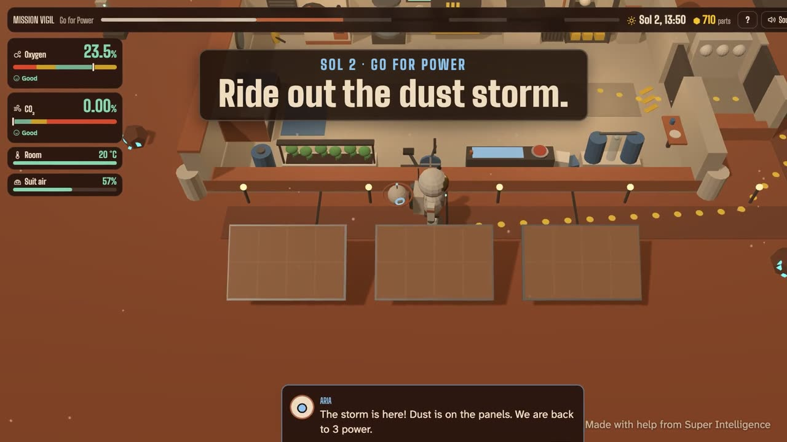
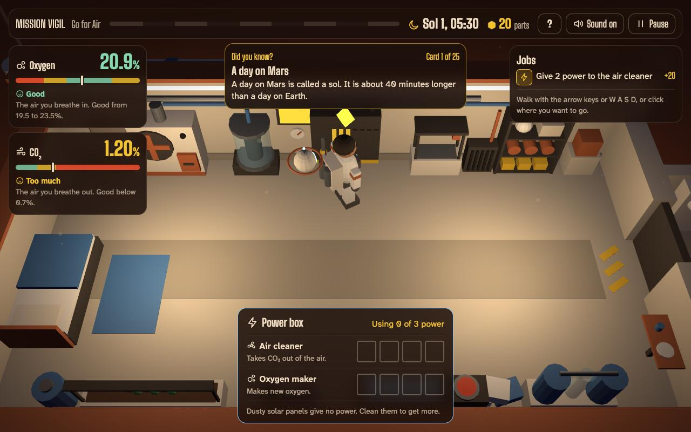
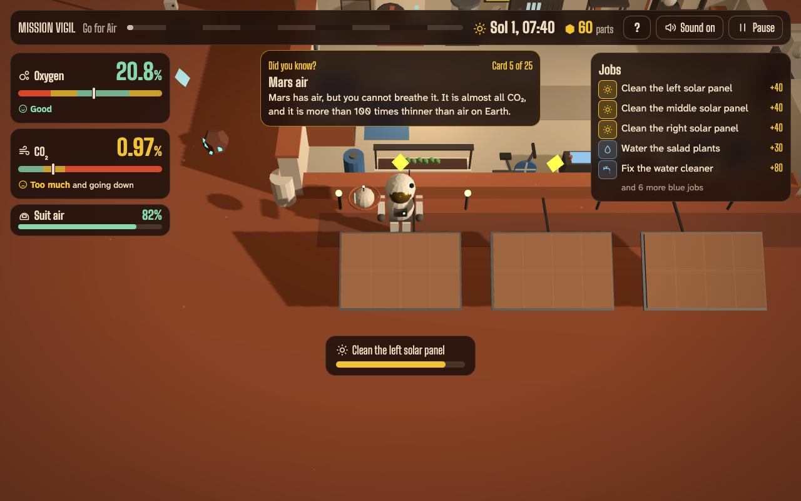
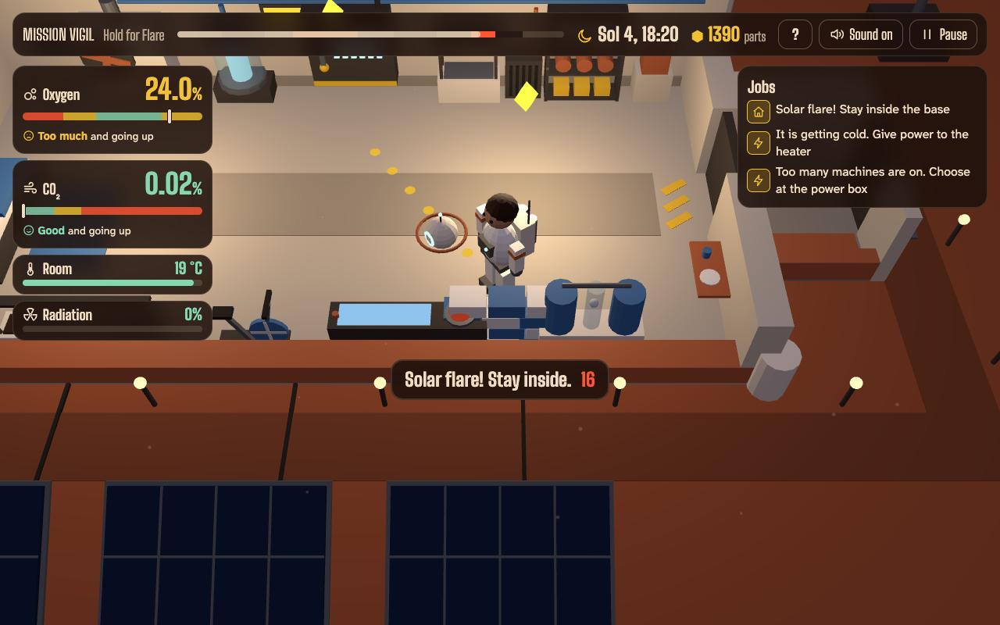
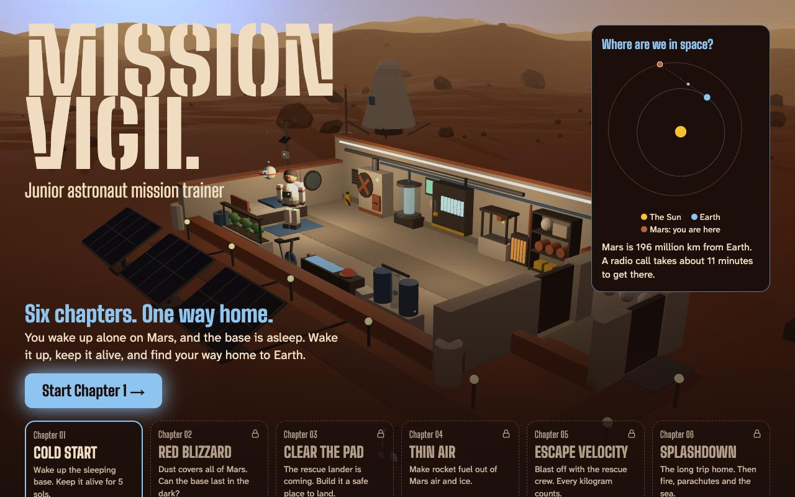

# MISSION VIGIL: Junior Astronaut Mission Trainer

**The base is asleep. The air is going bad. You have five sols to keep it alive.**

[▶ Play the mission](https://mission-vigil.vercel.app) · [▶ Watch the 30-second trailer](https://mission-vigil.vercel.app/media/trailer.mp4) · [Science & sources](SOURCES.md) · [Meet the team](#team-jointops) · [Run locally](#run-locally)

[](https://mission-vigil.vercel.app/media/trailer.mp4)

**[▶ Watch the 30-second trailer](https://mission-vigil.vercel.app/media/trailer.mp4)** (silent, with English text on screen and a subtitle track; the file is also in this repo at [`public/media/trailer.mp4`](public/media/trailer.mp4)). It shows real gameplay.

A browser game by **Team JointOps, Pakistan**, for the **NASA Space Apps Challenge 2026**. Players walk an astronaut through a Martian outpost, wake its systems one by one, and learn how one resource decision affects the rest of the mission. It runs in a web browser with nothing to install and no account.

---

## The challenge

> Build a Junior Astronaut Mission Trainer — an interactive game or app that lets students run a lunar or Martian outpost, balancing competing demands like life support, radiation shielding, power, and food production, so they experience firsthand the decisions that determine whether a mission fails or succeeds.

## Six chapters. One way home.

The story runs from a sleeping base on Mars to splashdown on Earth. **Chapter 1, *Cold Start*, is playable now.** Chapters 2 to 6 (*Red Blizzard*, *Clear the Pad*, *Thin Air*, *Escape Velocity* and *Splashdown*) are on the title screen as "Coming soon".

### Chapter 1: Cold Start, in five sols

A **sol** is a day on Mars. Each sol adds one new demand, and the earlier systems still need care.

| Sol | Mission | What the player balances |
| :--- | :--- | :--- |
| **01 · Go for Air** | Restore life support | Oxygen, CO₂, power, and heat |
| **02 · Go for Power** | Weather a dust storm | Solar output, heating, and air cleaning |
| **03 · Go for Harvest** | Grow food | Water, light, power, and time |
| **04 · Hold for Flare** | Respond to a solar flare | Shelter, radiation, and a habitat leak |
| **05 · Go for Home** | Call home | Communications and the systems keeping the base alive |

| | |
| :---: | :---: |
|  |  |
| A guided start teaches one control at a time | Clean the solar panels before the suit air runs out |
|  |  |
| Shelter from a solar flare | Six chapters; Chapter 1 is playable |

ARIA, a small flying helper robot, tells the story and guides the player. A yellow trail leads to each must-do job. Blue jobs are optional. Jobs pay parts, and the 3D printer turns parts into upgrades. Daily chores come back every morning, as they do for real crews. A "?" window answers the big questions at any time: what a sol is, why CO₂ matters, how far away Earth is.

**Learning and replay:** 25 "Did you know?" fact cards, each with its source. One of them is secret. There are also 6 badges, 5 hidden secrets for curious players, a rank, stars and a best score.

**Real data in the game:** the weather station shows 30 recent sols measured by the Curiosity rover. A live map shows where Earth and Mars are today and how long a radio message takes between them.

**The ending:** after a win, the player gets their stars and mission stats, then a short final check from Earth, then their badge and card collection. They can also save a postcard from Mars and print a certificate. The game gives time, event strength and some limits a game value so it plays well. [SOURCES.md](SOURCES.md) labels these as game rules.

## NASA data and resources we use

- **Curiosity rover REMS weather:** 30 sols of air temperature and pressure (NASA/JPL-Caltech/CAB), shown at the weather station.
- **NASA JPL orbit elements and constants:** used to place Earth and Mars on the live map and to work out the radio delay.
- **NASA technical reports (NTRS):** crew oxygen, CO₂, food and water needs, CO₂ limits, spacesuit oxygen, and how the Space Station crew responds to an emergency.
- **NASA mission results:** MOXIE, InSight, Spirit, Opportunity, Perseverance, the Space Station (water recycling, the 3D printer, growing lettuce, exercise), Orion's radiation shelter, and the NASA Mars Fact Sheet.

Every value and fact card is listed with its link in [SOURCES.md](SOURCES.md).

## Try it

**[Launch MISSION VIGIL →](https://mission-vigil.vercel.app)**

- **Keyboard:** arrow keys or WASD to move. E, Space or Enter to use a machine and to read on. P or Escape to pause.
- **Touch:** tap the ground to move, and tap a machine to use it. On a phone, tap a gauge to open it.
- Follow the guided start and the yellow trail to the next job. Blue markers show optional jobs.

The game keeps one thing in the browser's local storage: the best score. The name typed on the postcard stays on the page and is never stored or sent. There are no accounts or analytics, and the game collects no personal data.

## How it works

The interface and 3D scene are built with **Next.js, React, TypeScript, Three.js, React Three Fiber, and Tailwind CSS**. A plain TypeScript simulation models the systems, and **Zustand** connects it to the interface. The game uses no image, model, texture or audio files: the scene is procedural, the icons are hand-drawn SVG, and every sound is made with the Web Audio API. The screenshots and trailer in this README are captures of the game.

The 3D scene loads after the page, behind a short loading screen, so the controls work while it arrives. In our tests it held 60 frames per second mid-game, even with Chrome slowing the processor to a quarter of its speed, and the page changed about 20 times a second. We have not yet tested it on a low-end graphics chip.

The simulation keeps sourced values apart from game rules. See [SOURCES.md](SOURCES.md) for research and asset licences.

## Run locally

Use Node.js 24 (see `.nvmrc`) and npm:

```sh
npm ci
npm run dev
```

Open [localhost:3000](http://localhost:3000). For verification:

```sh
npm test
npm run lint
npm run build
npm run start   # the production build, for checking load time and frame rate
```

## Team JointOps

Team JointOps is based in Pakistan. Handles are Space Apps handles, not GitHub usernames.

| Member | Space Apps handle | Role |
| :--- | :--- | :--- |
| Shayan Hussain · Team Owner | @rockstarsb | Backend architecture, simulation and integration |
| AbdulMoiz Yousuf | @moizyousuf | Frontend architecture, screens, controls and accessibility |
| Owais Iqbal | @owaistar | AI, project management, game design, gameplay and 3D |
| Zoha Hasan | @zo._ha | Documentation, research, source checks and submission copy |
| Maha Waris Khan | @mahawaris | Frontend support, UI components and responsive layout |
| Sultan Nadeem | @sult4n | Systems design, technical strategy, mission mechanics and science integration |

## AI disclosure

Claude (Anthropic) assisted with the white paper, research, and code. OpenAI Codex assisted with repository setup and code. Claude also wrote the scripts that captured the screenshots and the trailer from the running game and edited the trailer together; the trailer shows real gameplay and carries a visible "Made with help from Super Intelligence" mark. Any AI-generated images must carry a visible watermark. The game scene is procedural and does not use image assets.

## Licence

[MIT](LICENSE). Third-party font licences and research sources are listed in [SOURCES.md](SOURCES.md).
